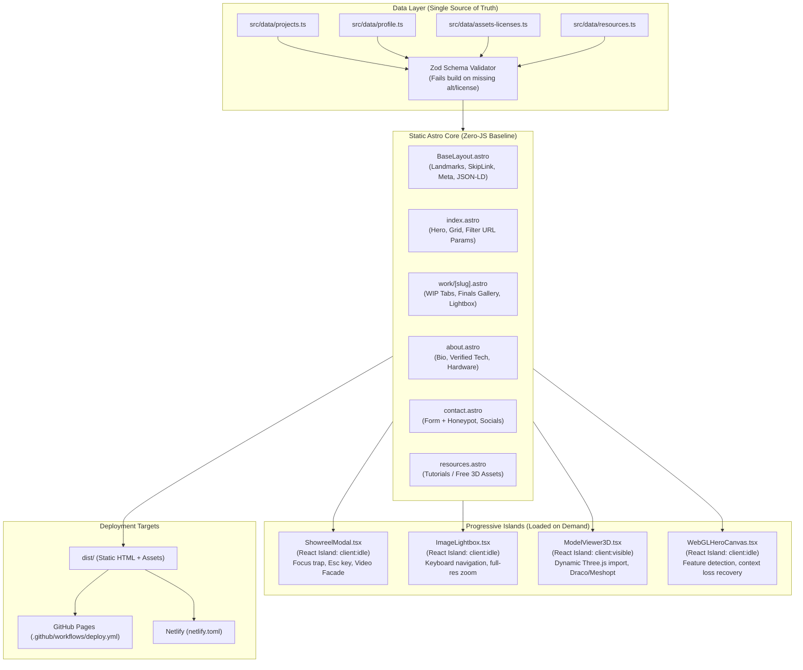
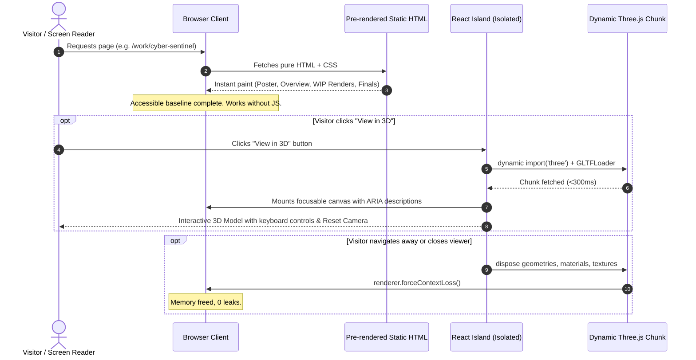

# Architecture & Technical Design

This document details the system architecture for **Ansh Kumar Singh's 3D Artist Portfolio**, showing how the static-first Astro engine integrates with React islands, progressive WebGL enhancements, and the typed data layer.

---

## 1. System Architecture Diagram

---

## 2. Progressive Enhancement Strategy

---

## 3. Accessibility & Fallback Matrix

| State / Condition | Behavior / Fallback |
| :--- | :--- |
| **JavaScript Disabled** | Complete site is navigable. All images, descriptions, WIP breakdowns, contact form, and category filters function normally. The 3D trigger shows the high-resolution poster image and written model details. |
| **`prefers-reduced-motion`** | Background hero video and hover previews are paused. Transitions are instantaneous. 3D viewer auto-rotation is disabled. |
| **`Save-Data: on`** | Autoplay videos are converted to click-to-load posters. 3D GLB models require explicit confirmation to fetch. |
| **WebGL Context Loss** | Captured via `webglcontextlost` event listener. Prevents browser crash, cleanly displays the labelled fallback poster and project summary, and surfaces a "Retry" button. |
| **Keyboard Operation** | Skip to main content link on all pages. Focus trap inside Showreel and Lightbox dialogs. Arrow keys orbit the 3D model, `+`/`-` zoom, and `R`/`Home` reset camera. |

